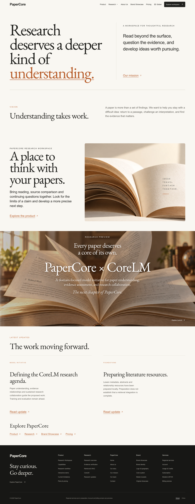
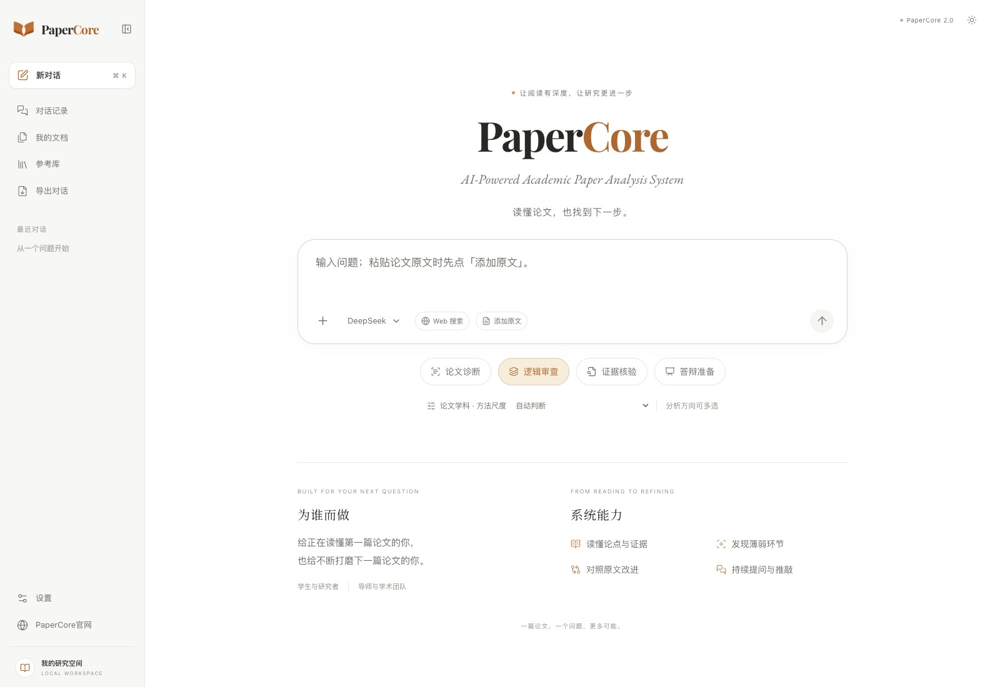
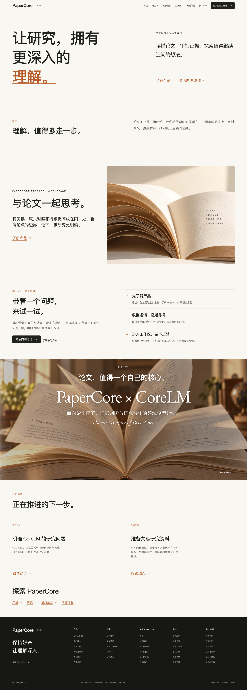
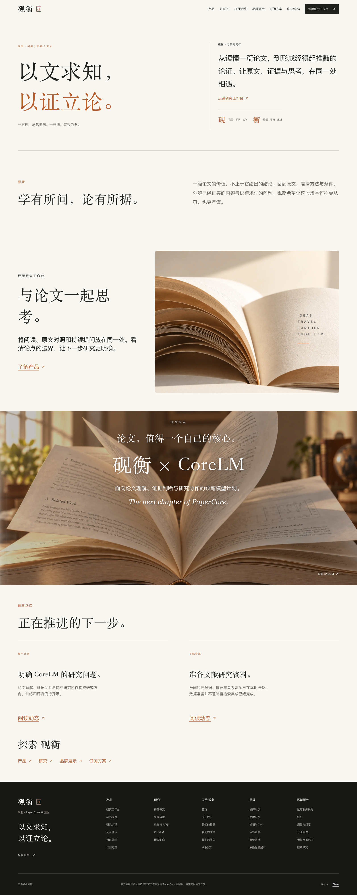

# PaperCore

**논문을 읽고, 근거를 확인하고, 주장을 다듬습니다.**

[English](README.md) · [简体中文](README.zh-CN.md) · 한국어

논문 진단 · 논리 검토 · 근거 확인 · 발표 및 심사 준비

---

## 연구를 읽고 질문하는 작업 공간

PaperCore는 학생과 연구자가 논문의 주장, 이를 뒷받침하는 근거와 추가 검토가 필요한 부분을 살펴보도록 돕습니다. 2.0 개발 버전은 원문과 이어지는 대화, 출처가 연결된 검색, 검토 과정을 추적할 수 있는 근거 확인을 결합합니다.

논문이나 질문으로 시작해 인용을 따라 원문을 확인하십시오. 근거가 있는 수정으로 논지를 다듬고, 아직 해결되지 않은 질문은 그대로 남겨 둡니다.

## 현재 개발 버전의 기능

| 작업 | 구현된 기능 |
|---|---|
| 맥락을 함께 읽기 | PDF, DOCX, 텍스트, Markdown 및 이미지 입력; 선택적 로컬 OCR과 설정된 비전 모델 |
| 논증 검토 | 논문 진단, 논리 검토, 근거 확인, 발표·심사 준비의 네 가지 방향을 조합 |
| 근거 추적 | 대화 옆 원문, 문단 인용 링크, 원문 읽기 기록과 근거의 공백 |
| 주장 확인 | 적용 범위 검사, 지지·반박 근거 검색, 원문 확인과 명시적인 미해결 상태 |
| 문장 다듬기 | 인용·수치·단위·계산 검사와 모델의 근거 관계 검토를 거친 복사 가능한 수정안 |
| 관련 문단 검색 | 선택적 의미·그래프 검색; 선택된 문단을 현재 원문과 대조 |
| 작업 이어가기 | 연구 목표와 미해결 질문 저장, 모델 전환, 대화 이름 변경·삭제, Markdown 내보내기와 응답 시간 표시 |

후속 대화에서는 토론, 특정 부분 수정과 새로운 주장을 구분합니다. 대화 입력창은 한 줄에서 시작해 내용에 따라 늘어나며, 홈페이지의 큰 입력창은 유지합니다. 현재 모델 이름을 눌러 모델을 바꾸고 **원문 추가** 기능으로 붙여 넣은 논문 내용을 인용 가능한 자료로 등록할 수 있습니다.

원래 주장이 미해결이어도 범위를 좁힌 수정안은 근거를 충족할 수 있습니다. 전문을 확보하지 못했거나 서비스 오류가 발생했다고 해서 과학적 주장이 거짓이라는 근거로 처리하지 않습니다. 자동 검사는 사람의 검토를 돕지만 과학적 정확성을 보장하지 않습니다.

최근에는 복잡한 표 머리글, 빈 셀과 수식 기호의 원문 검증을 추가했습니다. Swin에는 위치 또는 구조 확인이 필요한 항목 42개가 남아 있으며 정확한 위치만으로 의미가 검증되지는 않습니다. 작업 공간은 6개 분야군의 36개 연구 방향을 제공합니다. 자료 확보, 기계 검토와 사람의 확인을 구분하고, 중단 시 완료된 진행 상황을 보존합니다. 독립적인 사람의 평가는 아직 완료되지 않았습니다.

## 웹사이트와 지역별 작업 공간

웹사이트에는 Product, Research, CoreLM, About Us, Brand Showcase와 요금제 소개가 있습니다. Global과 China는 별도 지역 페이지를 제공하며 영어와 중국어 간체를 지원합니다. CoreLM은 전문 분야 모델 연구 계획이며 공개된 모델은 없습니다. 한국어는 현재 이 README에서 제공하며 제품 UI의 한국어 지원을 뜻하지 않습니다.

로컬 지역 서비스는 계정, 개인 연구 공간, 사용 기록, 명시적 비용 승인과 중단 지점 복구를 연결합니다. 개발용 서비스이며 공개 구독 상품이 아닙니다. **구매 절차와 실제 결제는 비활성화되어 있습니다.** 요금제와 크레딧 정책은 정리 중이며 테스트 크레딧은 구매한 이용량이 아닙니다.

## CoreLM 연구 진행 상황

팀원은 Qwen3-8B 기반의 합성 예제 396개 학습을 완료했습니다. 저장된 응답 검토에서 개발 과제의 완전 정답은 **26/60에서 44/60**으로 늘었지만, **잘못된 통과 판정 10건**이 생겼고 회귀 과제의 형식·필드 준수는 **12/12에서 5/12**로 떨어졌습니다. 따라서 **품질 검증 기준을 통과하지 못했으며**, PaperCore에 CoreLM 모델을 공개하거나 배포하지 않았습니다.

v1.4 팀원용 도구는 실행 시간 집계, 평가 일정과 복구를 개선합니다. 학습 예제를 추가하거나 새로운 학습 모델을 만든 버전이 아닙니다. 다음 단계는 팀원이 수정한 코드를 확인하고 기존 결과물을 평가한 뒤 추가 학습 여부를 판단하는 것입니다. 독립 테스트 세트는 봉인 상태를 유지합니다.

이 수치는 팀원의 과거 출력 검토 결과이며 이번에 새로 수행한 평가나 독립적으로 검증된 실제 논문 벤치마크가 아닙니다. 이 Showcase에서는 학습 코드, 데이터셋, 출력과 가중치를 배포하지 않습니다.

## 웹사이트 미리보기

웹사이트 디자인 일부는 [Anthropic](https://www.anthropic.com/)의 공식 웹사이트에서 영감을 받았습니다.

*2026년 11월 8일 Google Chrome으로 새로 촬영한 전체 페이지입니다(1600 × 4125). 탐색 메뉴, 연구 내용, CoreLM 미리보기와 푸터를 포함합니다. 로컬 빌드이며 공개 호스팅 서비스는 아직 없습니다.*

## 연구 작업 공간 미리보기

*2026년 11월 8일 Google Chrome으로 촬영한 데스크톱 홈페이지입니다(1600 × 1100). 사이드바와 푸터를 포함하며, 빈 로컬 작업 공간에서 웹 검색을 끄고 촬영했습니다. 업로드한 논문, 대화나 인증 정보는 없습니다. 화면은 중국어이며 흰색·따뜻한 색·어두운 테마를 지원합니다.*

## 초대 전용 베타 미리보기

별도 China 베타 웹사이트는 초대 활성화, 참여자 작업 공간과 문서 센터로 연결됩니다. 약관, 개인정보 고지, 자료 권한과 해당 외부 서비스 동의는 각각 기록합니다. 선택적인 데이터 활용 동의는 참여 동의와 분리됩니다. 작업을 복구할 때 원래 승인과 누적 사용량을 유지합니다.

10월 30일 한 인과관계 진단 및 제한적 수정 사례의 실제 재검증이 통과했습니다. 전체 참여자 경험과 운영 환경 검증은 아직 완료되지 않았습니다. 문서 센터는 1.1-rc1이며, 참여 계약 서명 연동과 최종 출시 승인은 미완료입니다. 11월 6일 공급자 검토 기한은 그대로 유지했고 현재 만료되었습니다.

*2026년 11월 8일 Google Chrome 전체 페이지 캡처입니다(1600 × 4457). 참여자 계정이나 연구 데이터는 포함하지 않습니다.*

## 독립 중국어 브랜드 미리보기

별도 웹사이트에서 **砚衡 · PaperCore 中国版(Yanheng)**과 “以文求知，以证立论。”이라는 문구를 탐색합니다. 현재 베타의 명칭과는 구분되는 브랜드 미리보기이며 서비스 출시를 의미하지 않습니다.

*2026년 11월 8일 격리된 로컬 빌드에서 Google Chrome으로 촬영했습니다(1600 × 4010).*

## 데이터와 연결 서비스

문서, 대화 이력과 근거 기록은 로컬에 저장합니다. 분석할 때 관련 텍스트와 이미지를 사용자가 설정한 모델 공급자에게 전송하며, 서비스 실패 시 설정된 다른 적격 모델이 이어받을 수 있습니다. 완전한 오프라인 분석 모드는 아닙니다.

선택적 의미 검색은 클라우드 임베딩·재정렬과 로컬 Chroma·LightRAG 인덱스를 사용합니다. 연구 메모리와 개발 메모리는 분리하며, 메모리·그래프에서 찾은 내용도 근거로 사용하기 전에 현재 원문과 대조합니다.

외부 문헌 검색은 기본적으로 꺼져 있습니다. 설정 가능한 출처는 OpenAlex, Crossref, arXiv, PMC/Europe PMC, Unpaywall과 선택적 AMiner, Semantic Scholar, Bocha입니다. 접근 가능 여부는 인증 정보와 서비스 상태에 따라 달라집니다. 중국 학술 서비스 연결은 검증 중이며 VIP를 검증 완료된 연동으로 소개하지 않습니다. Lewen은 연동되지 않았습니다.

Web 스위치는 외부 논문 검색을 제어하며 클라우드 모델·임베딩·재정렬 호출을 끄지는 않습니다. 검색 결과, 확보한 전문과 주장을 검증한 근거는 별도 상태로 기록합니다.

## 개발 상태

**PaperCore 2.0은 내부 개발 미리보기입니다.** 11월 8일 소스 업데이트에는 표·수식 원문 검증, 학문 분야별 검색 경로와 중단 처리, 자료 수집·검토 대기열, 베타 인과관계 검토 수정과 1.1-rc1 문서 양식이 포함됩니다. CoreLM 연구 상태는 변경되지 않았습니다. 소프트웨어 회귀 검사는 동작을 확인하며 과학적 정확성을 증명하지 않습니다.

두 번째 개발 단계의 전체 검증은 미완료입니다. 독립 검토자의 정답 기준, OCR 확인, 누락된 첨부 자료, 시각 응답 검증과 수식의 완전한 의미 검토가 남아 있습니다. 제한된 두 요청 동시 실행과 실제 공급자 전환을 확인했지만 운영 환경의 확장성이나 일반적인 안정성을 입증하지는 않습니다. 일부 과거 ConvNeXt 실행 기록은 누락되어 있습니다. CNKI는 연동되지 않았으며 공개 온라인 데모나 설치 패키지는 없습니다.

## 프로젝트와 의견

PaperCore는 **Zhu Houzhen(朱厚臻)**이 개발합니다. 이 저장소는 프로젝트 소개와 화면 미리보기만 포함하며 애플리케이션 소스는 비공개 저장소에 있습니다.

읽기 시나리오와 기능 제안은 [Issues](https://github.com/drkiyira-dev/PaperCore-Showcase/issues)로 보내 주십시오. 미공개 논문, 계정 정보나 API 키를 공개 보고서에 포함하지 마십시오.

## 저작권

Copyright © 2026 朱厚臻 (Zhu Houzhen). All rights reserved.

PaperCore는 독점 소프트웨어입니다. 이 저장소의 공개는 소프트웨어, 원문 또는 이미지에 대한 오픈소스 라이선스를 부여하지 않습니다. [LICENSE](LICENSE)를 확인하십시오. 이 한국어 안내는 기존 라이선스를 변경하지 않습니다.

---

PaperCore / Read with evidence.

